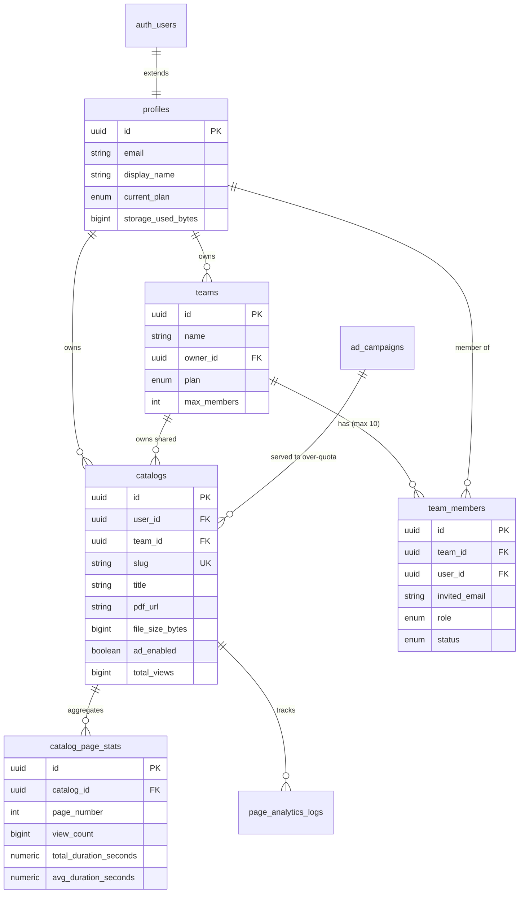

# 🚀 PEDEBOOK: SUPABASE MIGRATION & SYSTEM ARCHITECTURE 2.0
> **คู่มือและแผนงานการย้ายระบบสู่ Supabase, สกีมาฐานข้อมูล, ระบบสถิติรายหน้า, โมเดลแพ็กเกจใหม่ และโครงสร้างรองรับ Mobile App**

---

## 1. บทสรุปการเปลี่ยนแปลงหลัก (Executive Summary)

1. **ย้าย Database & Auth ไปยัง Supabase (PostgreSQL):**
   - ออกแบบสกีมาฐานข้อมูลระบบใหม่ทั้งหมด พร้อมฟังก์ชัน Triggers, Stored Procedures (RPC) และ Row Level Security (RLS)
   - ไฟล์ SQL พร้อมรันทันทีอยู่ที่: [`supabase/schema.sql`](./supabase/schema.sql)
2. **แยก Frontend และ Backend ชัดเจน (รองรับ Mobile App ต่อได้ทันที):**
   - มีชุด Universal RESTful API (`/api/v1/...`) สำหรับสื่อสารกับทั้ง Web Frontend และ Mobile App (iOS / Android / Flutter / React Native)
   - รองรับ Supabase Client SDK ทั้ง Client-side และ Server-side Admin
3. **ระบบสถิติการเปิดอ่านแยกรายหน้า (Page-by-Page Stay Duration Analytics):**
   - บันทึกเวลาที่ผู้อ่านเปิดค้างไว้ในแต่ละหน้าแบบเรียลไทม์ (มิลลิวินาที/วินาที)
   - มีแดชบอร์ด Heatmap & Bar Chart ให้เจ้าของสมุดดูว่า **"หน้าไหนคนอ่านนานที่สุด (Hot Page 🔥)"** และหน้าไหนถูกพลิกผ่านเร็ว
4. **โครงสร้างแพ็กเกจราคาใหม่ (Tiered Pricing & Ad Monetization):**
   - **Free (฿0):** พื้นที่ 100 MB **อัปโหลดเกินได้!** หากเกิน 100 MB ระบบจะเปิดการแสดงโฆษณาผู้สนับสนุนแบบข้ามไม่ได้ (Unblockable Ads 5s)
   - **Pro (฿49 / เดือน):** พื้นที่ 5 GB, ไม่มีโฆษณา 100%, ปลดล็อกลายน้ำ, ดูสถิติหน้าคนสนใจ
   - **Ultra (฿199 / เดือน):** พื้นที่ 50 GB (ตามมาตรฐานสากล SaaS), โลโก้แบรนด์ตัวเอง, แดชบอร์ด Heatmap เชิงลึก
   - **Business (฿599 / เดือน):** พื้นที่ 300 GB, **ระบบเชิญทีมงานได้สูงสุด 10 คนต่อทีม**, สิทธิ์รายบุคคล (Owner, Admin, Editor, Viewer)

---

## 2. ขั้นตอนการนำ SQL ไปรันบน Supabase (Step-by-Step)

เมื่อนายสร้างโปรเจกต์บน [Supabase Dashboard](https://supabase.com) เรียบร้อยแล้ว:

1. เข้าไปที่เมนู **SQL Editor** ในแถบซ้ายมือของ Supabase
2. กดปุ่ม **+ New Query**
3. คัดลอกโค้ดทั้งหมดจากไฟล์ [`supabase/schema.sql`](./supabase/schema.sql) มาวาง
4. กดปุ่ม **Run (Cmd + Enter หรือ Ctrl + Enter)**
5. สกีมาจะสร้าง Tables, Enums, Triggers, RLS Policies และ Stored Procedures ให้โดยอัตโนมัติ

*(ทางเลือกเพิ่มเติม: หากต้องการเพิ่มข้อมูลโฆษณาตัวอย่าง สามารถรันไฟล์ [`supabase/seed.sql`](./supabase/seed.sql) เพิ่มเติมได้ครับ)*

---

## 3. การใส่ Keys ใน `.env.local`

เมื่อได้ Keys จากหน้า **Project Settings -> API** ของ Supabase ให้นำมาใส่ใน `.env.local`:

```env
# Supabase Configuration
NEXT_PUBLIC_SUPABASE_URL=https://xxxxxxxxxxxx.supabase.co
NEXT_PUBLIC_SUPABASE_ANON_KEY=eyJhbGciOiJIUzI1NiIsInR5cCI6IkpXVCJ9...
SUPABASE_SERVICE_ROLE_KEY=eyJhbGciOiJIUzI1NiIsInR5cCI6IkpXVCJ9...

# Cloudflare R2 (สำหรับเก็บไฟล์ PDF และรูปภาพความเร็วสูง)
R2_ENDPOINT=https://xxxxxxxxxxxx.r2.cloudflarestorage.com
R2_ACCESS_KEY_ID=xxxxxxxxxxxx
R2_SECRET_ACCESS_KEY=xxxxxxxxxxxx
R2_BUCKET_NAME=catalog-files
R2_PUBLIC_DOMAIN=https://cdn.pedebook.com
```

---

## 4. โครงสร้างฐานข้อมูล (Database Schema Overview)



---

## 5. Universal Backend API (`/api/v1/...`) พร้อมใช้งานสำหรับ Mobile App

ระบบได้จัดเตรียม API แบบแยกส่วน (Decoupled REST API) เพื่อให้สามารถนำไปพัฒนาต่อเป็น **Mobile App (iOS / Android / Flutter / React Native)** ได้ทันที:

### 5.1 บันทึกสถิติเปิดหน้าสมุด (Ping Page View)
- **Endpoint:** `POST /api/v1/analytics/ping`
- **Payload:**
  ```json
  {
    "catalogId": "uuid-here",
    "pageNumber": 3,
    "durationSeconds": 14.5,
    "sessionId": "sess_123456",
    "deviceType": "mobile"
  }
  ```
- **การทำงาน:** เรียก Stored Procedure `record_page_stay_time` บน Supabase บันทึก Event และคำนวณค่าเฉลี่ยรายหน้าแบบ Atomic ทันที

### 5.2 ดึงสถิติรายหน้าและ Heatmap (Page Stats)
- **Endpoint:** `GET /api/v1/analytics/stats?catalogId={id}`
- **Response:**
  ```json
  {
    "success": true,
    "stats": [
      {
        "page_number": 1,
        "view_count": 120,
        "avg_duration_seconds": 12.4
      },
      {
        "page_number": 2,
        "view_count": 95,
        "avg_duration_seconds": 45.8
      }
    ]
  }
  ```

### 5.3 จัดการทีม (Team Collaboration - Max 10 Members)
- **Endpoint:** `GET /api/v1/teams?teamId={id}` หรือ `GET /api/v1/teams?userId={id}`
- **Endpoint:** `POST /api/v1/teams` (เชิญสมาชิกใหม่เข้าทีม พร้อมเช็คเงื่อนไขห้ามเกิน 10 คน)
  ```json
  {
    "teamId": "uuid-here",
    "email": "designer@company.com",
    "role": "editor"
  }
  ```

### 5.4 จัดการแค็ตตาล็อก (Catalogs CRUD)
- **Endpoint:** `GET /api/v1/catalogs?userId={id}` หรือ `GET /api/v1/catalogs?slug={slug}`
- **Endpoint:** `POST /api/v1/catalogs` (สร้างแค็ตตาล็อกใหม่)
- **Endpoint:** `GET /api/v1/catalogs/[id]` (ดึงรายละเอียดแค็ตตาล็อกรายเล่ม พร้อมสถิติหน้า)
- **Endpoint:** `PATCH /api/v1/catalogs/[id]` (แก้ไขชื่อ, ธีมพื้นหลัง, SEO, และการตั้งค่า)
- **Endpoint:** `DELETE /api/v1/catalogs/[id]` (ลบแค็ตตาล็อก และลบไฟล์ PDF บน R2 อัตโนมัติ)

### 5.5 ขอ Presigned URL อัปโหลดตรงเข้า R2 (สำหรับ Mobile App & Web)
- **Endpoint:** `POST /api/v1/upload/presign`
- **Payload:**
  ```json
  {
    "fileName": "summer-catalog-2026.pdf",
    "fileSize": 15420000,
    "contentType": "application/pdf",
    "userId": "user-uuid"
  }
  ```
- **Response:**
  ```json
  {
    "success": true,
    "presignedUrl": "https://...",
    "publicUrl": "https://cdn.pedebook.com/ebook/user-uuid/...",
    "key": "ebook/user-uuid/...",
    "expiresInSeconds": 3600
  }
  ```
- **การทำงานของ Mobile App:** แอปร้องขอ Presigned URL จาก Endpoint นี้ จากนั้นส่งไฟล์แบบ `PUT` ตรงเข้า Cloudflare R2 ได้ทันที ทำให้แอปทำงานได้เร็วมาก ไม่ต้องส่งไฟล์ผ่านเว็บเซิร์ฟเวอร์

### 5.6 ตรวจสอบแพ็กเกจ โควตา และสถานะโฆษณา (User Quota & Plan Status)
- **Endpoint:** `GET /api/v1/user/plan?userId={id}`
- **Response:**
  ```json
  {
    "success": true,
    "plan": { "id": "free", "storageMb": 100 },
    "storageUsedBytes": 115343360,
    "storageUsedMb": 110.0,
    "isOverQuota": true,
    "adsActive": true
  }
  ```

---

## 6. โมเดลโฆษณาสำหรับแพลนฟรีที่เกิน 100 MB (Unblockable Ads)

เมื่อผู้ใช้แพลนฟรีอัปโหลดไฟล์รวมเกิน 100 MB:
1. ฟังก์ชัน Trigger ใน PostgreSQL (`recalculate_user_storage_and_ads`) จะทำการปรับสถานะ `ad_enabled = TRUE` ให้กับแค็ตตาล็อกของผู้ใช้นั้นโดยอัตโนมัติ
2. เมื่อผู้ชมเปิดอ่านสมุดเล่มนั้น คอมโพเนนต์ [`UnblockableAdOverlay.tsx`](./app/components/UnblockableAdOverlay.tsx) จะทำงาน:
   - แสดงโฆษณาผู้สนับสนุนแบบมีเวลานับถอยหลัง 5 วินาที
   - เป็น First-Party Component ทำให้ Ad-Blocker ทั่วไปไม่สามารถตรวจจับหรือบล็อกได้
   - มีปุ่มเปิดดูข้อเสนอพิเศษของผู้สนับสนุน และปุ่มข้ามหลังจากครบ 5 วินาที
3. หากผู้ใช้ทำการอัปเกรดเป็นแพ็กเกจ Pro (49 บ.), Ultra (199 บ.) หรือ Business (599 บ.) ระบบจะปิดสถานะ `ad_enabled = FALSE` ทันที

---

## 7. ไฟล์และโค้ดที่สร้างเตรียมไว้เรียบร้อยในคืนนี้

| ลำดับ | ไฟล์ | หน้าที่ |
|---|---|---|
| 1 | [`supabase/schema.sql`](./supabase/schema.sql) | สกีมาฐานข้อมูล PostgreSQL ทั้งระบบ รันบน Supabase ได้ทันที |
| 2 | [`supabase/seed.sql`](./supabase/seed.sql) | ข้อมูลเริ่มต้นสำหรับทดสอบ (Seed Data) |
| 3 | [`app/src/lib/supabase/client.ts`](./app/src/lib/supabase/client.ts) | Supabase Client สำหรับฝั่ง Browser (Next.js Client Components) |
| 4 | [`app/src/lib/supabase/server.ts`](./app/src/lib/supabase/server.ts) | Supabase Admin Client สำหรับฝั่ง Backend/API Routes |
| 5 | [`app/src/lib/supabase/types.ts`](./app/src/lib/supabase/types.ts) | TypeScript Types ที่แมปตรงกับตารางใน Supabase 100% |
| 6 | [`app/src/lib/plans.ts`](./app/src/lib/plans.ts) | โมเดลราคา 4 แพ็กเกจ (Free, Pro 49.-, Ultra 199.-, Business 599.-) |
| 7 | [`app/src/hooks/usePageAnalytics.ts`](./app/src/hooks/usePageAnalytics.ts) | Hook ตรวจจับเวลาที่ผู้อ่านเปิดค้างในแต่ละหน้าแบบแม่นยำ |
| 8 | [`app/components/PageAnalyticsBoard.tsx`](./app/components/PageAnalyticsBoard.tsx) | แดชบอร์ดวิเคราะห์สถิติรายหน้า แสดงกราฟแท่งและ Hot Page |
| 9 | [`app/components/UnblockableAdOverlay.tsx`](./app/components/UnblockableAdOverlay.tsx) | คอมโพเนนต์โฆษณา 5 วิ แบบบล็อกไม่ได้ สำหรับแพลนฟรีที่เกิน 100 MB |
| 10 | [`app/api/v1/analytics/ping/route.ts`](./app/api/v1/analytics/ping/route.ts) | API รับ Ping เวลาอ่านรายหน้า (Beacon/Fetch) |
| 11 | [`app/api/v1/analytics/stats/route.ts`](./app/api/v1/analytics/stats/route.ts) | API ส่งข้อมูลสถิติรายหน้าให้แดชบอร์ดและ Mobile App |
| 12 | [`app/api/v1/teams/route.ts`](./app/api/v1/teams/route.ts) | API จัดการทีมและเชิญสมาชิก (จำกัดไม่เกิน 10 คน) |
| 13 | [`app/api/v1/catalogs/route.ts`](./app/api/v1/catalogs/route.ts) | API จัดการแค็ตตาล็อกสำหรับเว็บและ Mobile App |
| 14 | [`app/api/v1/user/plan/route.ts`](./app/api/v1/user/plan/route.ts) | API ตรวจสอบแพ็กเกจ โควตา และสถานะโฆษณา |
| 15 | [`app/pricing/page.tsx`](./app/pricing/page.tsx) | หน้าราคาและแพ็กเกจใหม่ 4 คอลัมน์ รองรับมือถือและคอมพิวเตอร์ |
| 16 | [`app/dashboard/page.tsx`](./app/dashboard/page.tsx) | แดชบอร์ดพร้อมปุ่มเปิดดูสถิติเปิดอ่านรายหน้าของแต่ละเล่ม |
